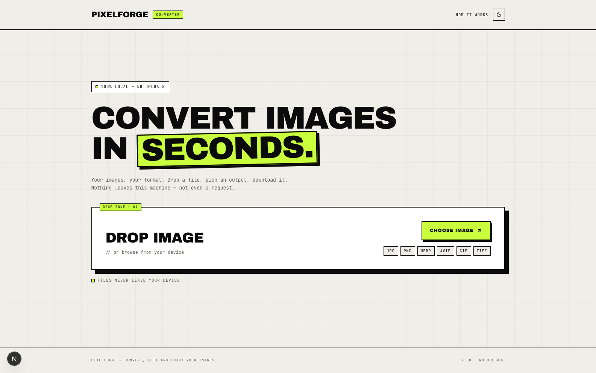
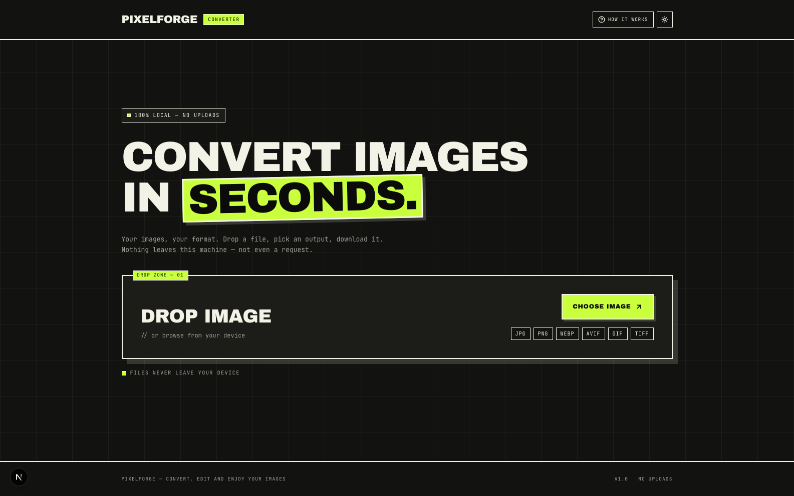
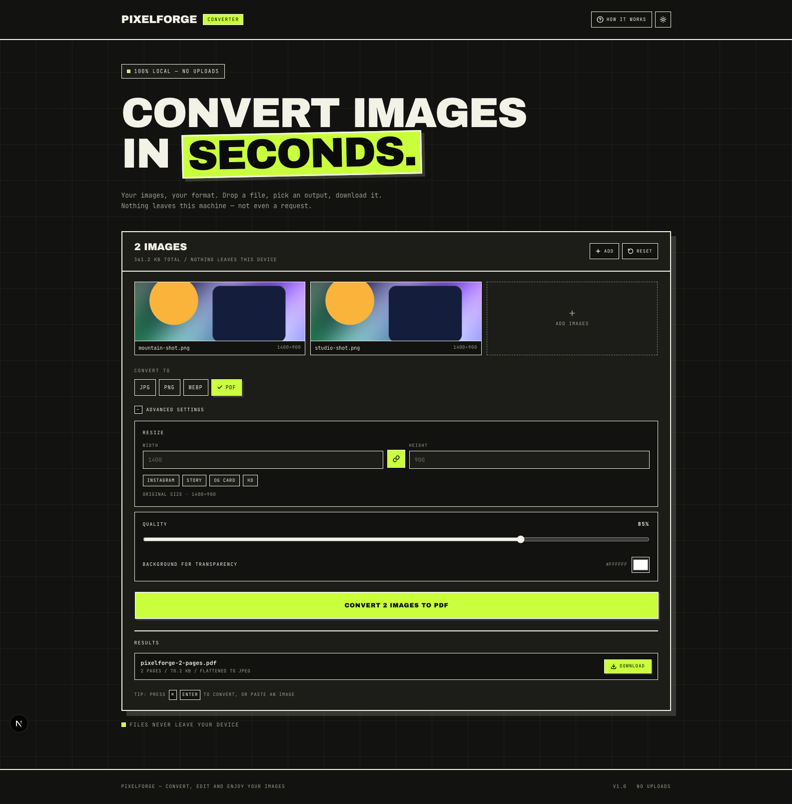

<div align="center">

# PixelForge

**Convert images in seconds — right in your browser.**

Drop an image, pick a format, resize it, hit convert, download it. No uploads,
no accounts, no server round-trips. Every pixel is decoded and re-encoded
locally with the Canvas API.

[](https://nextjs.org)
[](https://react.dev)
[](https://tailwindcss.com)
[](https://www.typescriptlang.org)
[](https://github.com/Devesh-NEMO/PixelForge/actions/workflows/ci.yml)

</div>







---

## Features

- **100% client-side** — files never leave the device. There is no upload
  endpoint, no database, and no analytics on image data.
- **Batch conversion** — drop several files at once, remove individual ones, and
  download each result or the whole set as a ZIP.
- **Resize** — type a width or height (the other follows the aspect ratio),
  unlock the ratio to stretch, or pick a preset (Instagram, Story, OG card, HD).
- **Target file size** — ask for “under 200 KB” and the encoder binary-searches
  the quality that fits.
- **Format detection** — the app probes the browser's real encoders and only
  offers those, so you never get a silently mislabelled file.
- **HEIC input** — iPhone photos are decoded with a lazily-loaded WASM helper.
- **Before/after compare** — a draggable slider shows the converted result
  against the original.
- **Transparency handling** — converting to JPG flattens alpha onto a background
  colour you pick (white by default).
- **Paste, drag, or browse** — `Ctrl/⌘ + V` adds an image from the clipboard,
  dropping works anywhere on the card, and `Ctrl/⌘ + Enter` converts.
- **Shareable presets** — `/?format=webp&q=80&w=1280` pre-configures the tool.
- **Light and dark themes** — a header toggle that follows your OS preference on
  first visit, then remembers your choice in `localStorage` (no flash on reload).
- **Works offline** — a service worker caches the shell, so the app keeps
  working without a connection.

## Supported formats

| Direction  | Formats                                                                                              |
| ---------- | ---------------------------------------------------------------------------------------------------- |
| **Input**  | JPG, PNG, WebP, AVIF, GIF, BMP, SVG, HEIC/HEIF — anything the browser (or the HEIC decoder) can read |
| **Output** | JPG, PNG, WebP, plus AVIF where the browser implements it                                            |

Honest details:

- **AVIF** support is probed at runtime with
  `canvas.toDataURL("image/avif")` and hidden when the engine falls back to PNG.
- **GIF and TIFF** appear on the landing card as decorative chips, not output
  options — the Canvas API cannot encode either. Animated inputs are flattened
  to their first frame.
- **PNG** is lossless, so the quality slider and target size are hidden for it.

## Tech stack

| Layer        | Choice                                                               |
| ------------ | -------------------------------------------------------------------- |
| Framework    | Next.js 16 (App Router, Turbopack)                                   |
| UI           | React 19, TypeScript (strict)                                        |
| Styling      | Tailwind CSS v4 — CSS-first `@theme` tokens, no `tailwind.config.js` |
| Type         | Plus Jakarta Sans via `next/font` (self-hosted at build time)        |
| Icons        | lucide-react                                                         |
| Image engine | `OffscreenCanvas` in a Web Worker, with a main-thread fallback       |
| Extras       | `fflate` (ZIP), `heic2any` (HEIC decode, lazy-loaded)                |
| Tests        | Vitest (unit) + Playwright (end-to-end)                              |
| Formatting   | Prettier                                                             |

> **On ESLint:** the project targets TypeScript 7, which `typescript-eslint`
> does not support yet. Type safety comes from `tsc --noEmit` under `strict`
> plus `next build`; ESLint can be added once the parser catches up.

## Getting started

**Requirements:** Node.js 20.9 or newer (developed on Node 24) and npm.

```bash
git clone https://github.com/Devesh-NEMO/PixelForge.git
cd PixelForge
npm install
npm run dev
```

Open [http://localhost:3000](http://localhost:3000).

> **Note:** prefer `http://localhost:3000`. Next.js 16 only lets its dev client
> connect from known origins, so opening the app through `127.0.0.1` can render
> the page without interactivity. `next.config.js` already lists `127.0.0.1` in
> `allowedDevOrigins`, but `localhost` is the safest choice.

### Scripts

| Command                | What it does                        |
| ---------------------- | ----------------------------------- |
| `npm run dev`          | Start the dev server                |
| `npm run build`        | Production build (also type-checks) |
| `npm start`            | Serve the production build          |
| `npm run typecheck`    | `tsc --noEmit`                      |
| `npm run test`         | Unit tests (Vitest)                 |
| `npm run test:e2e`     | End-to-end tests (Playwright)       |
| `npm run format`       | Format with Prettier                |
| `npm run format:check` | Verify formatting (used in CI)      |

## Project structure

```
pixelforge/
├── app/
│   ├── layout.tsx               # Fonts, metadata, PWA hook
│   ├── page.tsx                 # Landing: hero, converter, privacy note
│   ├── convert/page.tsx         # Legacy route — 307 redirect to /
│   ├── error.tsx                # Route-level error boundary
│   ├── not-found.tsx            # 404
│   ├── favicon.ico              # 16/32/48 favicon (every browser)
│   ├── icon.svg                 # Scalable favicon (modern browsers)
│   ├── apple-icon.png           # iOS home-screen icon
│   ├── manifest.ts              # Web app manifest
│   ├── globals.css              # Tailwind import, theme tokens, utilities
│   └── fonts/                   # Self-hosted Archivo Black + JetBrains Mono
├── components/
│   ├── image-converter.tsx      # Composition only: hooks + panels
│   ├── converter/
│   │   ├── drop-zone.tsx        # Empty state and format chips
│   │   ├── preview-grid.tsx     # Thumbnails, per-file remove, add tile
│   │   ├── format-picker.tsx    # Output format pills
│   │   ├── resize-panel.tsx     # Width/height, aspect lock, presets
│   │   ├── output-settings.tsx  # Quality, target size, background
│   │   └── results-list.tsx     # Per-file results and the PDF card
│   ├── theme-toggle.tsx         # Light/dark switch (localStorage + system default)
│   ├── compare-dialog.tsx       # Before/after slider
│   ├── how-it-works.tsx         # Modal explainer
│   ├── service-worker.tsx       # Registers /sw.js in production
│   ├── site-header.tsx
│   └── site-footer.tsx
├── hooks/
│   ├── use-image-jobs.ts        # Files, HEIC, object URLs, removal
│   └── use-conversion.ts        # Settings + queue loop (raster & PDF)
├── lib/
│   ├── formats.ts               # Format table + encoder probing
│   ├── image.ts                 # Pure helpers (sizes, resize, quality search)
│   ├── pdf.ts                   # Dependency-free PDF writer (one JPEG per page)
│   ├── job.ts                   # Job / PdfResult types
│   ├── cn.ts                    # Class-name join
│   ├── convert-types.ts         # Worker message contract
│   └── convert-client.ts        # Worker orchestration + main-thread fallback
├── workers/convert.worker.ts
├── tests/                       # Vitest unit tests
├── e2e/                         # Playwright specs
├── public/
│   ├── og.png                   # Social card
│   ├── sw.js                    # Offline service worker
│   └── icons/                   # PWA icons
├── preview.png                  # Screenshots used in this README
├── preview-converter.png
└── .github/workflows/ci.yml
```

## How it works

1. **Pick files** — drag-and-drop, the file dialog, a paste event, or a landing
   chip. HEIC files are decoded to PNG first (the helper is imported on demand),
   then every file is previewed through a revoked-on-change object URL and probed
   for its natural dimensions.
2. **Choose settings** — output format, optional resize box, quality, and an
   optional target size. Shareable presets come from the query string.
3. **Convert** — files are posted to a Web Worker, which decodes with
   `createImageBitmap` (honouring EXIF orientation), draws onto an
   `OffscreenCanvas`, and re-encodes with `convertToBlob`. A zero width/height
   means “keep the natural size”. For a target size, a binary search over quality
   finds the best encode that fits. Choosing PDF encodes each image to JPEG and
   stitches the pages together with the writer in `lib/pdf.ts`.
4. **Download** — results become blob URLs behind native `<a download>` links; a
   ZIP button packages the whole batch with `fflate`.

A run-id guard cancels in-flight work when the selection changes, and object URLs
are tracked and revoked on removal, reset, and unmount.

If `OffscreenCanvas` or workers are unavailable, the same pipeline runs on the
main thread, so the app degrades instead of breaking.

## Testing

```bash
npm run test        # 20 unit tests for the pure helpers
npm run test:e2e    # Playwright: upload, convert, resize, batch + ZIP
```

The end-to-end suite starts its own dev server (port 3100) and inlines its PNG
fixture, so it needs no external files. CI runs typecheck, unit tests, formatting,
build, and the Playwright suite on every push.

## Privacy and security

- No network calls after load — enforced by a production
  `Content-Security-Policy` with `connect-src 'self'`.
- `X-Content-Type-Options`, `Referrer-Policy`, `Permissions-Policy`, and
  `frame-ancestors 'none'` are set in `next.config.js`.
- The service worker only caches same-origin GETs and never posts anything.

## Browser support

**Chrome / Edge 111+**, **Safari 16.4+**, **Firefox 128+**. Tailwind CSS v4 emits
modern CSS (`color-mix()`, `@property`, `oklab`) that older engines cannot parse.
The worker pipeline needs `OffscreenCanvas` (Chrome 69+, Firefox 105+,
Safari 16.4+); without it the app falls back to the main thread.

## Deployment

Any Node host works; there is no server-side state. On Vercel: import the
repository, accept the defaults, deploy. Set `NEXT_PUBLIC_SITE_URL` to your
domain so the Open Graph URLs resolve absolutely.

```bash
npm run build   # verify locally first
npm start
```

## Known limitations

- Animated GIF/WebP inputs convert only their first frame.
- GIF, TIFF, BMP and ICO outputs are not possible with `canvas.toBlob`.
- AVIF output depends on the browser; there is no WASM AVIF encoder yet.
- Images above 60 megapixels are rejected to protect mobile tabs.
- All jobs share one output format — per-file formats are not implemented.
- HEIC decoding happens on the main thread and can take a moment for large photos.
- PDF pages are flattened JPEG images — no vector content, no text layer, and
  transparent areas take the chosen background colour.

## Contributing

Issues and pull requests are welcome. Before opening a PR:

```bash
npm run typecheck && npm run test && npm run format:check && npm run build
```

## License

No license has been chosen for this repository yet. Until one is added, the code
is “all rights reserved” by default — add a `LICENSE` file (MIT is a good default)
if you intend to let others use it.
